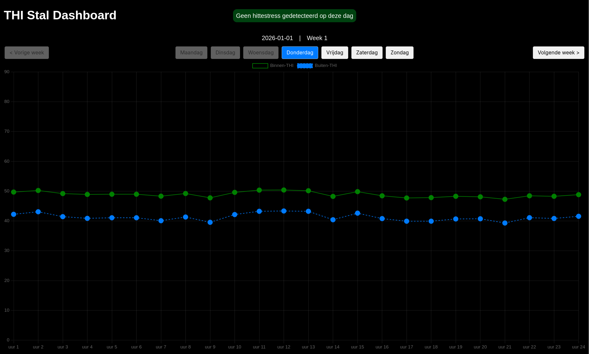

# Stal Dashboard - Hittestress-monitor

Een webdashboard ontworpen om de hittestress (THI) in een stal te monitoren. Het dashboard verwerkt KNMI-weerdata per uur, 
berekent de binnen-THI en visualiseert deze in lijngrafieken met duidelijke waarschuwingen voor hittestress bij koeien.

**Website** - [Bekijk hier het dashboard](https://pieterhboterhoek.github.io/THI-Stal-Dashboard/)




## Functionaliteiten
* **Uur-precisie grafieken:** Visualiseert de binnen-THI per uur via **Chart.js**.
* **Hittestress-waarschuwingen:** Automatische markering (kleurverandering van punten naar groen/oranje/rood) en een statusbanner wanneer de THI-grens van **68** wordt overschreden.
* **Week- en dagnavigatie:** Blader eenvoudig door de weken/dagen van het jaar.
* **Responsive design:** Bekijk het dashboard gemakkelijk op mobile en desktop.

## Toegepaste Formules
Het dashboard berekent de **NRC THI-formule** op basis van de buitenwaarden (Tout, RHout):

1. **Binnentemperatuur (Tin​):** *Tin​=0,879⋅Tout​+4,68*
2. **Binnen-luchtvochtigheid (RHin​):** *RHin​=0,651⋅RHout​+0,239⋅Tout​+15,40*
3. **NRC THI-formule (binnen-THI):** *THIin​=(1,8⋅Tin​+32)−(0,55−0,0055⋅RHin​)⋅(1,8⋅Tin​−26)*
4. **NRC THI-formule (Buiten-THI):** *THIout​=(1,8⋅Tout​+32)−(0,55−0,0055⋅RHout​)⋅(1,8⋅Tout​−26)*

## Technische Stack
* **Frontend:** HTML5, CSS3, JavaScript
* **Visualisatie:** [Chart.js](https://www.chartjs.org/)
* **Data:** KNMI weerdata in JSON-formaat (`weerdata.json`) [KNMI Website](https://daggegevens.knmi.nl/klimatologie/uurgegevens)
* **Hosting:** GitHub Pages

## Lokale installatie
Clone deze repository naar je lokale machine en gebruik bijvoorbeeld een live server plugin om het te draaien:
```bash
git clone https://github.com/PieterHBoterhoek/THI-Stal-Dashboard
